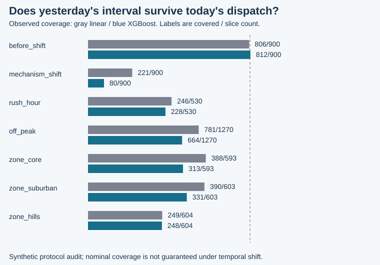

# Dispatch ETA Lab

**A better point estimate can still make a worse delivery promise.**

I built this original CPU experiment to connect regression quality with an operational decision: how much time should a fictional dispatch service promise? An actual XGBoost regressor competes with a fitted linear baseline. Separate past-only residuals calibrate intervals. A declared disruption then tests whether those intervals still describe the future.

The result keeps the difficult part visible: XGBoost's pre-shift average error is smaller, but its narrower calibrated interval fails badly after the mechanism changes. Under the predeclared simulation weights, the linear upper-endpoint promise has lower loss on the complete test stream. This is a useful boundary to discover before a customer sees a promise.

**Original independent portfolio work by Vedant Thaker, November 5, 2026.** All deliveries, routes, couriers, service zones and outcomes are synthetic. This is not Uber, DoorDash, Instacart, employer or customer data, and it does not validate any historical job metric.

## Start with the engineering story

- [Executed case study](reports/case-study.md): narrow problem, ordinary workflow, failure mode, framework, result, tradeoff and next action.
- [Metrics and source hashes](reports/metrics.json), [every held-out prediction](reports/predictions.csv), and [the exact synthetic dataset](reports/data/deliveries.csv.gz).
- [Data card](data/DATA_CARD.md) and [protocol/method references](docs/protocol.md).



## Run it

Tested on Python 3.11.9, NumPy 1.26.0, SciPy 1.11.2, scikit-learn 1.3.0 and XGBoost 3.1.2. Use Python 3.11 for the pinned wheels.

```powershell
python -m venv .venv
.venv\Scripts\Activate.ps1
python -m pip install -r requirements.txt
python -m unittest discover -s tests -v
python -m dispatch_eta demo --out reports
```

On macOS/Linux, activate with `source .venv/bin/activate`. Linux x86_64 requirements select the official `xgboost-cpu` package; other platforms select `xgboost`, always with `device=cpu`. The [official installation guide](https://xgboost.readthedocs.io/en/stable/install.html#minimal-installation-cpu-only) explains the CPU variant. The program uses no API keys, external dataset, cloud allocation, provider call or GPU. Dependency installation requires internet access; the experiment itself does not.

Keep a fresh run separate from the committed result:

```powershell
python -m dispatch_eta demo --out runs/another-check --seed 73
python -m dispatch_eta report --out runs/another-check
```

The CLI defaults numerical thread environment settings to one process-local thread, respecting explicit caller overrides. XGBoost itself uses one worker thread. Model parameters and seed are declared inputs, not choices searched for a favorable test result.

## The implementation contract

| Layer | What is implemented |
| --- | --- |
| Event grain | One fictional dispatch with known-at-dispatch traffic, distance, queue/supply, weather, basket and service-zone inputs |
| Time | Train days `[0,18)`, calibration `[20,24)`, test `[26,36)`; two-day gaps; earlier labels must exist before the next partition |
| Identity | Route/courier cohorts disjoint across all three partitions; IDs and absolute day/time are excluded from model inputs |
| Baseline | OLS on the same 11 engineered inputs and training rows as the tree model |
| Candidate | CPU `XGBRegressor`, histogram trees, fixed parameters, no calibration/test tuning or early stopping |
| Uncertainty | Absolute-residual split conformal, exact finite-sample order statistic, separate pre-test calibration, nonnegative support clipping |
| Decision | Point promise versus upper-endpoint promise, missed-promise counts, late/slack minutes and transparent illustrative loss weights |
| Audit | Rush/off-peak, service zone, original/shift period and shifted-zone slices, raw predictions and denominator checks |

The declared mechanism shift adds an unobserved delivery delay from day 31 onward. Its diagnostic flag is never a feature. Calibration stays frozen rather than silently adapting to test labels.

## What the result supports

This is a reproducible implementation of ETA regression, calibration and promise accounting on one published synthetic mechanism. It shows why model error, interval coverage and policy loss need separate acceptance criteria. A nominal 90% split-conformal interval has the usual marginal guarantee only under the required exchangeability conditions; chronological splitting does not create them, shift violates them, and global coverage does not guarantee each subgroup.

The loss uses four illustrative units per late minute and one per slack minute. Those units are not money, customer satisfaction, cancellation rates or field ROI. The simulation cannot measure the causal effect of displaying a different ETA. It does not implement live dispatch, route optimization, availability classification, distributed training, a production API or a real-time feature platform.

## Where to review the code

| File | Review question |
| --- | --- |
| [data.py](dispatch_eta/data.py) | Were features known at dispatch, labels mature and identities separated? |
| [experiment.py](dispatch_eta/experiment.py) | Did both estimators fit only training data, and were parameters fixed? |
| [intervals.py](dispatch_eta/intervals.py) | Is the conformal rank correct, including small-sample/unbounded cases? |
| [evaluate.py](dispatch_eta/evaluate.py) | Do coverage, tail misses, promise loss and empty denominators reconcile? |
| [report.py](dispatch_eta/report.py) | Do the story and chart come from measured JSON rather than hand-entered results? |
| [tests](tests/test_contracts.py) | Do leakage, interval, business-metric and raw-artifact contracts hold? |

A pinned [GitHub Actions workflow](.github/workflows/verify.yml) runs the tests and a small CPU experiment. Local execution is recorded here; remote CI status should be checked on the repository after publication.

## Inspiration and rights

The [user-supplied LinkedIn post](https://www.linkedin.com/posts/andresvourakis_xgboost-and-similar-tree-based-models-are-share-7523776256539029505-auas/) supplied the topic direction. [Uber's 2019 engineering article](https://www.uber.com/us/en/blog/productionizing-distributed-xgboost/) provides a primary historical example of XGBoost applied to ETA estimation at a very different scale. This project does not replicate that architecture or claim to describe Uber's current stack. No post/article code, company dataset, result number or diagram is copied.

The statistical method is credited to [Lei et al., Distribution-Free Predictive Inference for Regression](https://arxiv.org/abs/1604.04173); API references and the assumptions are recorded in [the protocol](docs/protocol.md). Original code, fictional data and reports are released under the [MIT license](LICENSE). Dependencies retain their own licenses.
