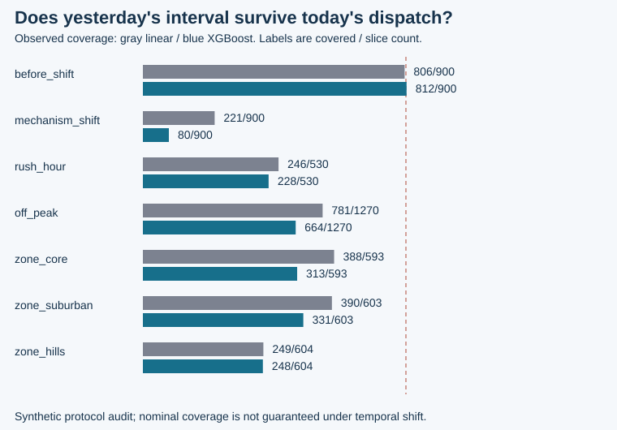

# Dispatch ETA under an abrupt change in delivery times

A model can predict typical delivery time accurately and still quote an unreliable arrival window when routes slow down. This experiment compares point forecasts, interval coverage and the cost of two ways to set a promise.

This is original independent work by Vedant Thaker. Every delivery is fictional. No Uber, DoorDash, Instacart, employer or customer data, code, benchmark result or production claim is used as this experiment's evidence.

## Two promises for the same delivery

For each held-out delivery, one policy displays the point estimate and the other displays the upper endpoint of its calibrated interval. The evaluation counts how often each promise is missed, how late it is and how much extra time customers would have been quoted on early deliveries.

## What changes after calibration

The final period introduces a delivery-time shift after calibration. A single average over the entire test period masks when the promised interval stopped covering arrivals. Before-shift and during-shift rows keep that failure visible.

## Training window, calibration window and promise policy

1. **Clock:** use known-at-dispatch inputs. Keep route/courier identities disjoint between train, calibration and test; exclude identities, absolute day, shift flags, outcomes and completion fields from features. Leave two-day gaps and require earlier labels to be available before the next partition.
2. **Estimate:** fit OLS and an actual CPU XGBoost regressor on the same training rows and feature columns. Parameters are fixed before the run; neither calibration nor test labels select a model or stop boosting.
3. **Calibrate:** use only the separate pre-test calibration residuals. For nominal coverage 90%, select absolute-residual rank `ceil((n+1)*(1-alpha))`: 649 of 720. The XGBoost radius is 5.52 minutes. Lower endpoints are clipped to the known nonnegative duration support.
4. **Promise:** compare displaying the point estimate with displaying the interval's upper endpoint. Count missed promises, mean late minutes and extra promise slack. Use predeclared illustrative loss weights of four per late minute and one per slack minute.
5. **Audit:** keep all test predictions and show the original/shifted periods and service-zone/rush-hour slices. The shift flag is an analysis label, never a predictor or a trigger available to a deployed policy.

## Forecast errors by period and service zone

The generated stream contains 6480 events. The train/calibration/test counts are 3240/720/1800; 720 events fall in excluded gap days.

| Model | Test deliveries | MAE minutes | Interval coverage | Mean interval width | Underestimated by >10 minutes |
| --- | ---: | ---: | ---: | ---: | ---: |
| linear | 1800 | 7.50 | 57.06% | 14.66 | 516 |
| xgboost | 1800 | 7.20 | 49.56% | 11.05 | 503 |

| XGBoost slice | Deliveries | MAE minutes | Covered / evaluated | Mean width | Actual above upper endpoint |
| --- | ---: | ---: | ---: | ---: | ---: |
| all | 1800 | 7.20 | 892/1800 | 11.05 | 880 |
| before_shift | 900 | 2.62 | 812/900 | 11.05 | 60 |
| mechanism_shift | 900 | 11.77 | 80/900 | 11.05 | 820 |
| off_peak | 1270 | 6.42 | 664/1270 | 11.05 | 596 |
| rush_hour | 530 | 9.05 | 228/530 | 11.05 | 284 |
| shift_zone_core | 305 | 9.50 | 40/305 | 11.05 | 265 |
| shift_zone_hills | 306 | 17.04 | 2/306 | 11.05 | 304 |
| shift_zone_suburban | 289 | 8.59 | 38/289 | 11.05 | 251 |
| zone_core | 593 | 5.97 | 313/593 | 11.05 | 279 |
| zone_hills | 604 | 10.25 | 248/604 | 11.05 | 338 |
| zone_suburban | 603 | 5.34 | 331/603 | 11.05 | 263 |

Before the declared shift, XGBoost coverage is 90.22%; during the shift it is 8.89%. These are observed counts on one constructed stream. The standard split-conformal finite-sample guarantee needs exchangeability; it is not guaranteed by chronological splitting, and the explicit disruption violates it. Global marginal coverage also does not promise coverage in each zone or rush-hour subgroup.

## Cost of lateness and slack

| Model and promise policy | Missed promises / deliveries | Mean late minutes | Mean slack minutes | Mean illustrative loss units |
| --- | ---: | ---: | ---: | ---: |
| linear: point_promise | 1308/1800 | 6.64 | 0.86 | 27.41 |
| linear: upper_promise | 737/1800 | 2.48 | 4.07 | 14.01 |
| xgboost: point_promise | 1335/1800 | 6.57 | 0.63 | 26.90 |
| xgboost: upper_promise | 880/1800 | 3.28 | 2.86 | 15.98 |

Late and slack minutes are averaged over all evaluated deliveries, including zeros. The upper endpoint can reduce missed promises while increasing the amount of time quoted beyond actual completion. The weights are transparent preferences, not customer-loss estimates, currency, observed satisfaction or ROI. This simulation does not model demand changes caused by a longer promise, dispatcher choices, cancellations or intervention feedback. It cannot establish causal business impact.

XGBoost's test MAE is lower than the linear baseline (7.20 versus 7.50 minutes). Its mean interval width is narrower than the linear interval (11.05 versus 14.66 minutes). Under the fixed simulation weights, XGBoost-upper promise loss is higher than linear-upper loss (15.98 versus 14.01 illustrative units). These are separate measured comparisons; choosing a policy on one synthetic stream does not establish deployment readiness or causal business value.

## Applying the result to a delivery service

A real promise policy would need delivery outcomes from multiple time windows, the actual arrival time of each feature and label, and an operator-defined cost for lateness versus slack. Before changing a displayed ETA, a shadow evaluation could measure those two costs per service zone and rush-hour window. Any revised calibration rule would need past-only labels and a fresh holdout.

## Reproduce and challenge

Run `python -m dispatch_eta demo --out reports`, then `python -m unittest discover -s tests -v`. `python -m dispatch_eta report --out reports` regenerates the narrative/chart from the saved numerical evidence without fitting again.

- [Metrics and source hashes](metrics.json)
- [Every held-out prediction](predictions.csv)
- [Exact original synthetic dataset](data/deliveries.csv.gz)
- [Data card](../data/DATA_CARD.md)
- [Protocol and references](../docs/protocol.md)

Dataset CSV SHA-256: `d405b5b4ae9b89e272ce7cc48ba5ac40bfc0b9b0a5a9d2327363830220944dc3`.
