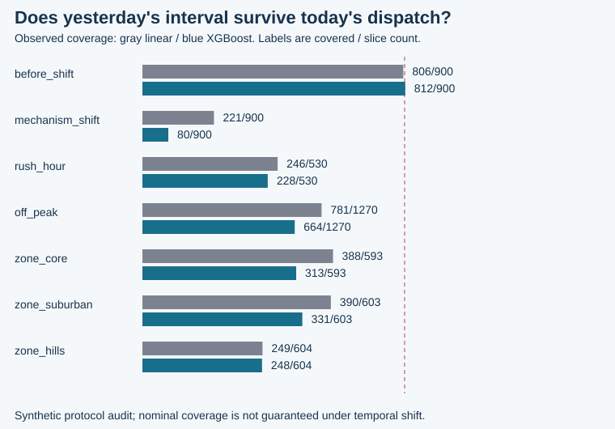

# Dispatch ETA Lab: the promise is a decision

**Decision: Keep this as an offline protocol audit. Point error, interval coverage and promise loss require separate acceptance criteria.**

This is original independent work by Vedant Thaker. Every delivery is fictional. No Uber, DoorDash, Instacart, employer or customer data, code, benchmark result or production claim is used as this experiment's evidence.

## The topic, then the narrower question

An ETA is a regression output, but a displayed delivery promise is an operational commitment. I wanted to test whether a tree model improves a simple baseline and whether its uncertainty still describes the cases where a promise matters: rush hour, different service zones and a changed delivery mechanism.

## The usual workflow and the issue I chose to expose

It is easy to fit a model, report one average error and turn every prediction into a promise. That hides late arrivals behind early ones, obscures who receives wide intervals, and can let future route/courier information enter an apparently clean test. An uncertainty interval adds another failure mode: its familiar nominal level can sound like a guarantee even when calibration and future deliveries are no longer exchangeable.

## My framework: clock, estimate, calibrate, promise, audit

1. **Clock:** use known-at-dispatch inputs. Keep route/courier identities disjoint between train, calibration and test; exclude identities, absolute day, shift flags, outcomes and completion fields from features. Leave two-day gaps and require earlier labels to be available before the next partition.
2. **Estimate:** fit OLS and an actual CPU XGBoost regressor on the same training rows and feature columns. Parameters are fixed before the run; neither calibration nor test labels select a model or stop boosting.
3. **Calibrate:** use only the separate pre-test calibration residuals. For nominal coverage 90%, select absolute-residual rank `ceil((n+1)*(1-alpha))`: 649 of 720. The XGBoost radius is 5.52 minutes. Lower endpoints are clipped to the known nonnegative duration support.
4. **Promise:** compare displaying the point estimate with displaying the interval's upper endpoint. Count missed promises, mean late minutes and extra promise slack. Use predeclared illustrative loss weights of four per late minute and one per slack minute.
5. **Audit:** keep all test predictions and show the original/shifted periods and service-zone/rush-hour slices. The shift flag is an analysis label, never a predictor or a trigger available to a deployed policy.

## Actual executed result

The generated stream contains 6480 events. The train/calibration/test counts are 3240/720/1800; 720 events fall in excluded gap days.

| Model | Test deliveries | MAE minutes | Interval coverage | Mean interval width | Underestimated by >10 minutes |
| --- | ---: | ---: | ---: | ---: | ---: |
| linear | 1800 | 7.50 | 57.06% | 14.66 | 516 |
| xgboost | 1800 | 7.20 | 49.56% | 11.05 | 503 |

| XGBoost slice | Deliveries | MAE minutes | Covered / evaluated | Mean width | Actual above upper endpoint |
| --- | ---: | ---: | ---: | ---: | ---: |
| all | 1800 | 7.20 | 892/1800 | 11.05 | 880 |
| before_shift | 900 | 2.62 | 812/900 | 11.05 | 60 |
| mechanism_shift | 900 | 11.77 | 80/900 | 11.05 | 820 |
| off_peak | 1270 | 6.42 | 664/1270 | 11.05 | 596 |
| rush_hour | 530 | 9.05 | 228/530 | 11.05 | 284 |
| shift_zone_core | 305 | 9.50 | 40/305 | 11.05 | 265 |
| shift_zone_hills | 306 | 17.04 | 2/306 | 11.05 | 304 |
| shift_zone_suburban | 289 | 8.59 | 38/289 | 11.05 | 251 |
| zone_core | 593 | 5.97 | 313/593 | 11.05 | 279 |
| zone_hills | 604 | 10.25 | 248/604 | 11.05 | 338 |
| zone_suburban | 603 | 5.34 | 331/603 | 11.05 | 263 |

Before the declared shift, XGBoost coverage is 90.22%; during the shift it is 8.89%. These are observed counts on one constructed stream. The standard split-conformal finite-sample guarantee needs exchangeability; it is not guaranteed by chronological splitting, and the explicit disruption violates it. Global marginal coverage also does not promise coverage in each zone or rush-hour subgroup.

## The decision layer makes the tradeoff visible

| Model and promise policy | Missed promises / deliveries | Mean late minutes | Mean slack minutes | Mean illustrative loss units |
| --- | ---: | ---: | ---: | ---: |
| linear: point_promise | 1308/1800 | 6.64 | 0.86 | 27.41 |
| linear: upper_promise | 737/1800 | 2.48 | 4.07 | 14.01 |
| xgboost: point_promise | 1335/1800 | 6.57 | 0.63 | 26.90 |
| xgboost: upper_promise | 880/1800 | 3.28 | 2.86 | 15.98 |

Late and slack minutes are averaged over all evaluated deliveries, including zeros. The upper endpoint can reduce missed promises while increasing the amount of time quoted beyond actual completion. The weights are transparent preferences, not customer-loss estimates, currency, observed satisfaction or ROI. This simulation does not model demand changes caused by a longer promise, dispatcher choices, cancellations or intervention feedback. It cannot establish causal business impact.

XGBoost's test MAE is lower than the linear baseline (7.20 versus 7.50 minutes). Its mean interval width is narrower than the linear interval (11.05 versus 14.66 minutes). Under the fixed simulation weights, XGBoost-upper promise loss is higher than linear-upper loss (15.98 versus 14.01 illustrative units). These are separate measured comparisons; choosing a policy on one synthetic stream does not establish deployment readiness or causal business value.

## The tradeoff and next action

Trees can capture interactions that a linear baseline misses. Calibration makes one uncertainty assumption inspectable; it does not repair a changed process. I would next test multiple predeclared time windows and seeds on authorized representative data, observe actual feature/label arrival times, and choose a promise-loss function with the operator. A monitored shadow rollout would compare interval misses and slack by group before a customer sees a new promise. Any recalibration policy needs fresh past-only labels and its own predeclared evaluation.

## Reproduce and challenge

Run `python -m dispatch_eta demo --out reports`, then `python -m unittest discover -s tests -v`. `python -m dispatch_eta report --out reports` regenerates the narrative/chart from the saved numerical evidence without fitting again.

- [Metrics and source hashes](metrics.json)
- [Every held-out prediction](predictions.csv)
- [Exact original synthetic dataset](data/deliveries.csv.gz)
- [Data card](../data/DATA_CARD.md)
- [Protocol and references](../docs/protocol.md)

Dataset CSV SHA-256: `d405b5b4ae9b89e272ce7cc48ba5ac40bfc0b9b0a5a9d2327363830220944dc3`.
